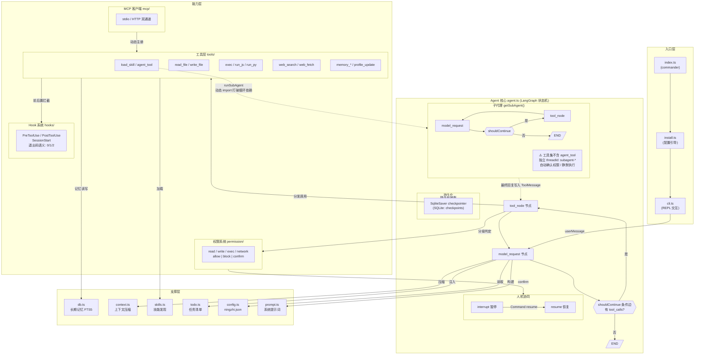

# ningzhi-cli 项目面试要点

> 用途：面试前复习准备。内容均基于项目真实实现，可放心在面试中展开讲述。

---

## 一、简历项目介绍（完整版）

**项目名称**：基于 LangGraph 的终端 AI Agent 框架架构设计与实现（ningzhi-cli）

**技术栈要点**：TypeScript、Node.js、LangChain/LangGraph、SQLite (FTS5 全文检索)、MCP 协议、Commander.js、Jest

**项目简介**：主导设计并实现运行于终端的个人 AI Agent 框架，集成工具调用、长期记忆、技能系统、Hook 机制、子代理与 MCP 扩展能力，形成覆盖模型编排、权限安全、上下文工程与状态持久化的完整 Agent 解决方案，并发布至 npm。

**工作内容与成果**：

1）基于 LangGraph 设计双节点（model_request ⇄ tool_node）Agent 状态机架构，通过条件边实现模型推理与工具执行的自主循环（ReAct 模式），结合 SqliteSaver 检查点持久化实现会话随时恢复、任务清单跨会话不丢失，每个会话以 thread_id 隔离。

2）设计插件化工具架构：13 个工具独立模块化开发，通过工厂函数统一注册并注入权限等级标签，支持通过 MCP 协议动态接入第三方工具服务器（stdio/HTTP 双通道），实现工具生态的可扩展性。

3）构建三级安全防御体系：read/write/exec/network 四类权限分级判定（含危险命令黑名单、路径安全校验、域名白名单）+ PreToolUse/PostToolUse 双阶段 Hook 拦截（基于退出码语义协议，支持阻断与消息注入）+ 基于 interrupt/resume 的人工确认闭环，实现危险操作全链路可控。

4）设计多层递进的上下文压缩策略：基于 40+ 模型上下文窗口元数据驱动的 LLM 摘要压缩、历史工具消息简化（仅保留最近 3 条完整输出）、500 条消息硬上限兜底，有效解决长对话上下文爆炸问题；并实现基于 SQLite FTS5 与 BM25/重要性/时间衰减混合评分（0.6/0.3/0.1 加权）的长期记忆检索系统。

5）打造高质量终端交互体验：流式 Markdown 实时渲染、ESC 键实时中断（并修复了中止后孤立 tool_calls 导致消息历史非法的边界问题）、单例 readline 规避 Windows 下 stdin 状态抖动；核心模块 Jest 测试全覆盖，最终发布至 npm 支持全局安装。

---

## 二、项目架构总览（口述用）

```
┌─────────────────────────────────────────────────┐
│ 入口层  index.ts (commander) → install.ts → cli.ts (REPL) │
├─────────────────────────────────────────────────┤
│ Agent 核心  agent.ts (LangGraph 状态机)          │
│   ├── model_request ⇄ tool_node 循环             │
│   ├── SqliteSaver checkpointer (状态持久化)       │
│   └── interrupt/resume (人工确认)                 │
├──────────┬──────────┬──────────┬────────────────┤
│ 工具层    │ 权限系统  │ Hook系统  │ MCP 客户端 | subAgent │
├──────────┴──────────┴──────────┴────────────────┤
│ 支撑层  db(记忆) │ context(压缩) │ skills │ todo │ config │ prompt │
└─────────────────────────────────────────────────┘
```

### 总体架构图（Mermaid）



一句话定位：**用 LangGraph 编排的、带权限与记忆的终端 ReAct Agent，借鉴了 Claude Code 的 Hook/Skill/权限确认设计**。

### 核心文件速查索引

| 模块         | 文件路径                                                                                                     |
| ------------ | ------------------------------------------------------------------------------------------------------------ |
| Agent 状态机 | [agent.ts](file:///c:/Users/56801/Desktop/OpenClaw-dev/ningzhi-cli/src/agent/agent.ts)                       |
| CLI 交互     | [cli.ts](file:///c:/Users/56801/Desktop/OpenClaw-dev/ningzhi-cli/src/agent/cli.ts)                           |
| 工具注册     | [tools.ts](file:///c:/Users/56801/Desktop/OpenClaw-dev/ningzhi-cli/src/agent/tools.ts)                       |
| 上下文压缩   | [context.ts](file:///c:/Users/56801/Desktop/OpenClaw-dev/ningzhi-cli/src/agent/context.ts)                   |
| 记忆数据库   | [db.ts](file:///c:/Users/56801/Desktop/OpenClaw-dev/ningzhi-cli/src/agent/db.ts)                             |
| 权限系统     | [permission/](file:///c:/Users/56801/Desktop/OpenClaw-dev/ningzhi-cli/src/agent/permission)                  |
| Hook 系统    | [hooks/engine.ts](file:///c:/Users/56801/Desktop/OpenClaw-dev/ningzhi-cli/src/agent/hooks/engine.ts)         |
| MCP 客户端   | [mcp/](file:///c:/Users/56801/Desktop/OpenClaw-dev/ningzhi-cli/src/agent/mcp)                                |
| 技能系统     | [skills.ts](file:///c:/Users/56801/Desktop/OpenClaw-dev/ningzhi-cli/src/agent/skills.ts)                     |
| 系统提示词   | [prompt.ts](file:///c:/Users/56801/Desktop/OpenClaw-dev/ningzhi-cli/src/agent/prompt.ts)                     |
| 配置加载     | [config.ts](file:///c:/Users/56801/Desktop/OpenClaw-dev/ningzhi-cli/src/agent/config.ts)                     |
| 模型封装     | [model.ts](file:///c:/Users/56801/Desktop/OpenClaw-dev/ningzhi-cli/src/agent/model.ts)                       |
| 子代理工具   | [tools/agent_tool.ts](file:///c:/Users/56801/Desktop/OpenClaw-dev/ningzhi-cli/src/agent/tools/agent_tool.ts) |

---

## 三、高频面试问题与回答要点

### 1. LangGraph 状态机（必问）

**Q: 为什么用 LangGraph 而不是直接写循环？**

- 状态机声明式描述 Agent 流程，图结构天然支持条件边（`shouldContinue` 判断最后一条 AIMessage 是否有 tool_calls）
- checkpointer 持久化、interrupt 人机协同是框架内置能力，自己写要处理很多边界
- 📍 源码：[agent.ts#L123 createAgentGraph](file:///c:/Users/56801/Desktop/OpenClaw-dev/ningzhi-cli/src/agent/agent.ts#L123)、[agent.ts#L78 shouldContinue](file:///c:/Users/56801/Desktop/OpenClaw-dev/ningzhi-cli/src/agent/agent.ts#L78)

**Q: reducer 机制是什么？**

- State 中 `messages` 用内置 `messagesStateReducer`：按消息 id 去重、追加新消息、支持删除/替换
- 其余字段（contextSummary、compressionCount、todoList）用简单覆盖 reducer（next 替换 prev）
- 关键点：**todoList 被 SqliteSaver 自动持久化**，压缩上下文或重启会话都不丢失
- 📍 源码：[agent.ts#L47 StateAnnotation](file:///c:/Users/56801/Desktop/OpenClaw-dev/ningzhi-cli/src/agent/agent.ts#L47)、[agent.ts#L120 checkpointer](file:///c:/Users/56801/Desktop/OpenClaw-dev/ningzhi-cli/src/agent/agent.ts#L120)

**Q: interrupt/resume 人工确认流程？**

1. tool_node 中权限判定为 confirm 的调用，通过 `interrupt({ toolCalls })` 暂停图执行
2. 外层 `_runAgent` 轮询 `compiledAgent.getState()`，发现 interrupts 非空的任务
3. 把待确认清单通过回调交给 CLI 层，用户决策
4. 用 `Command({ resume: "approved" | "denied" })` 恢复执行，interrupt() 的返回值即 resume 的值
5. 拒绝时为每个调用生成 "denied by user" 的 ToolMessage，保证消息历史合法

- 📍 源码：[agent.ts#L161 toolNode](file:///c:/Users/56801/Desktop/OpenClaw-dev/ningzhi-cli/src/agent/agent.ts#L161)、[agent.ts#L547 runAgentStream](file:///c:/Users/56801/Desktop/OpenClaw-dev/ningzhi-cli/src/agent/agent.ts#L547)

### 2. 上下文压缩（亮点，易深挖）

**三层递进策略：**

1. **LLM 摘要压缩**：内置 40+ 模型的上下文窗口表（MODEL_CONTEXT_LIMITS），接近上限时把历史对话压成摘要存入 `contextSummary`，记录 `lastCompressedIndex`
2. **工具消息简化**：`simplifyToolMessages` 只保留最近 3 条 ToolMessage 完整内容，旧的替换为 `[Previous: used xxx]` 占位符（read_file 豁免，因为文件内容常需反复参考）
3. **硬防线**：modelRequest 里 `slice(-500)`，极端场景兜底

- 📍 源码：[context.ts#L10 MODEL_CONTEXT_LIMITS](file:///c:/Users/56801/Desktop/OpenClaw-dev/ningzhi-cli/src/agent/context.ts#L10)、[context.ts#L113 compressMessages](file:///c:/Users/56801/Desktop/OpenClaw-dev/ningzhi-cli/src/agent/context.ts#L113)、[agent.ts#L91 simplifyToolMessages](file:///c:/Users/56801/Desktop/OpenClaw-dev/ningzhi-cli/src/agent/agent.ts#L91)

**追问点：**

- 为什么保留最近 3 条工具消息？→ 给模型保留短期反馈上下文，既省 token 又不丢最近执行结果
- `lastCompressedIndex` 如何拼接？→ 请求时构造 `[摘要SystemMessage, ...messages.slice(lastCompressedIndex)]`，摘要只覆盖已压缩部分，新消息完整保留
- 为什么压缩不影响持久化？→ 压缩只发生在"发给模型的视图"构建阶段，checkpoint 里存的是完整消息历史
- 📍 源码：[context.ts#L149 findSafeCompressionIndex](file:///c:/Users/56801/Desktop/OpenClaw-dev/ningzhi-cli/src/agent/context.ts#L149)、[agent.ts#L583 compressContext](file:///c:/Users/56801/Desktop/OpenClaw-dev/ningzhi-cli/src/agent/agent.ts#L583)

### 3. 长期记忆检索（数据库能力体现）

**Q: 检索方案设计？**

- SQLite FTS5 虚拟表做全文检索（external content 模式，`content='memory'`）
- 3 个触发器（insert/delete/update）保证主表与 FTS 索引同步，删除用 `'delete'` 命令语法
- 📍 源码：[db.ts#L151 initDb](file:///c:/Users/56801/Desktop/OpenClaw-dev/ningzhi-cli/src/agent/db.ts#L151)、[db.ts#L169 FTS5虚拟表](file:///c:/Users/56801/Desktop/OpenClaw-dev/ningzhi-cli/src/agent/db.ts#L169)、[db.ts#L38 searchMemories](file:///c:/Users/56801/Desktop/OpenClaw-dev/ningzhi-cli/src/agent/db.ts#L38)

**Q: 混合评分公式？**

```
final_score = BM25相关性×0.6 + importance×0.3 + 时间衰减×0.1
时间衰减 = 1 / (1 + 距今天数)
```

- 相关性为主、重要性次之、时间衰减防陈旧记忆霸榜
- 30 秒讲清权衡：纯 BM25 会忽略人工标注的重要性；纯重要性会让旧记忆永远置顶

**Q: 用户画像和记忆为什么分流？**

- profile.md 文件存"用户是谁"（姓名、偏好等稳定信息），每次进 SystemPrompt
- memory 表存"发生过什么"（事件、决策），按需检索
- 避免"用户叫什么"这类信息污染检索结果
- 📍 源码：[prompt.ts readProfile](file:///c:/Users/56801/Desktop/OpenClaw-dev/ningzhi-cli/src/agent/prompt.ts)、[memory_create_tool.ts](file:///c:/Users/56801/Desktop/OpenClaw-dev/ningzhi-cli/src/agent/tools/memory_create_tool.ts)

### 4. 权限与安全体系

**四级权限 × 三种决策：**

- 工具经工厂函数打上 `permission_level` 标签（read/write/exec/network/mcp）
- 决策三态：`allow` 直接执行 / `block` 返回原因作 ToolMessage（模型可感知，能自我修正）/ `confirm` 走 interrupt 人工确认
- 具体策略：exec 拦截危险命令（rm 等）、write 对照 dangerous-path.json 黑名单、web_fetch 校验域名白名单、MCP 工具默认全部确认
- 📍 源码：[tools.ts#L27 createNingzhiTool](file:///c:/Users/56801/Desktop/OpenClaw-dev/ningzhi-cli/src/agent/tools.ts#L27)、[exec.ts#L18 checkExecPermission](file:///c:/Users/56801/Desktop/OpenClaw-dev/ningzhi-cli/src/agent/permission/exec.ts#L18)、[write.ts#L4 checkWritePermission](file:///c:/Users/56801/Desktop/OpenClaw-dev/ningzhi-cli/src/agent/permission/write.ts#L4)、[read.ts#L3 checkReadPermission](file:///c:/Users/56801/Desktop/OpenClaw-dev/ningzhi-cli/src/agent/permission/read.ts#L3)

**Q: block 的原因为什么返回给模型而不是直接抛错？**

- 形成反馈闭环：模型知道为什么被拒，下一轮会调整参数或换方案，而不是死循环重试

### 5. Hook 系统（借鉴 Claude Code）

- 三类：PreToolUse / PostToolUse / SessionStart，配置于 `~/.ningzhiAgentCli/ningzhi.json`
- matcher 支持通配 `*` 或工具名包含匹配，shell 命令执行，上下文经环境变量传递
- **退出码即语义协议**：0 → 继续；1 → block（stderr 作拒绝原因）；2 → inject（stderr 注入对话，工具仍执行）
- inject 的用途举例：参数不规范时注入修正提示，工具照样执行，节省一轮交互
- 📍 源码：[engine.ts#L32 matchHooks](file:///c:/Users/56801/Desktop/OpenClaw-dev/ningzhi-cli/src/agent/hooks/engine.ts#L32)、[engine.ts#L40 runHook](file:///c:/Users/56801/Desktop/OpenClaw-dev/ningzhi-cli/src/agent/hooks/engine.ts#L40)、[engine.ts#L76 runPreToolUseHooks](file:///c:/Users/56801/Desktop/OpenClaw-dev/ningzhi-cli/src/agent/hooks/engine.ts#L76)、[engine.ts#L110 runPostToolUseHooks](file:///c:/Users/56801/Desktop/OpenClaw-dev/ningzhi-cli/src/agent/hooks/engine.ts#L110)

### 6. 工程化细节（区分度高，主动讲能加分）

**Q: 循环依赖怎么解决？**

- 链路：agent.ts → tools.ts → agent_tool.ts → agent.ts
- agent_tool 内部用 `await import("../agent")` 动态 import，运行时才解析，打破模块加载期的环
- 📍 源码：[agent_tool.ts#L1](file:///c:/Users/56801/Desktop/OpenClaw-dev/ningzhi-cli/src/agent/tools/agent_tool.ts#L1)

**Q: ESC 中止后为什么要清理孤立 tool_calls？**

- AbortController 中断时，AI 消息里可能已有 tool_calls 但对应的 ToolMessage 还没生成
- OpenAI 兼容 API 校验 tool_calls 与 ToolMessage 必须成对，否则下轮请求报 "insufficient tool messages"
- 解决：abort 后扫描消息历史，为孤立 tool_calls 补充"已取消"状态的 ToolMessage
- 📍 源码：[agent.ts#L411 cleanupOrphanedToolCalls](file:///c:/Users/56801/Desktop/OpenClaw-dev/ningzhi-cli/src/agent/agent.ts#L411)、[cli.ts#L85 escListener](file:///c:/Users/56801/Desktop/OpenClaw-dev/ningzhi-cli/src/agent/cli.ts#L85)

**Q: Windows 下 readline 的坑？**

- 反复 createInterface/close 导致 stdin 在 flowing/paused 间切换，表现为"提示符显示但打字没反应"
- 解决：全局单一 readline 接口复用
- 另一个坑：rl.question 结束内部会 pause stdin，导致 ESC keypress 监听失效，需主动 `process.stdin.resume()`
- 📍 源码：[cli.ts#L19 rl 单例](file:///c:/Users/56801/Desktop/OpenClaw-dev/ningzhi-cli/src/agent/cli.ts#L19)、[cli.ts#L28 emitKeypressEvents](file:///c:/Users/56801/Desktop/OpenClaw-dev/ningzhi-cli/src/agent/cli.ts#L28)、[cli.ts#L95 stdin.resume](file:///c:/Users/56801/Desktop/OpenClaw-dev/ningzhi-cli/src/agent/cli.ts#L95)

**Q: 工具输出太长怎么办？**

- `maybePersistedOutput` 把超长输出落盘成文件，ToolMessage 里只留文件路径，模型需要时用 read_file 读取
- 📍 源码：[tools.ts#L311 maybePersistedOutput](file:///c:/Users/56801/Desktop/OpenClaw-dev/ningzhi-cli/src/agent/tools.ts#L311)

### 7. 子代理（SubAgent）

**Q: 子代理是怎么实现的？和主代理有什么区别？**

子代理复用**同一套 `createAgentGraph` 工厂**（同一个 LangGraph 状态机结构），通过 `initAgent` 时实例化两个图：

```typescript
// initAgent 中
agent = createAgentGraph(tools); // 主代理：全部 13 个工具
subAgent = createAgentGraph(tools.filter((t) => t.name !== "agent_tool")); // 子代理：排除 agent_tool
```

**核心差异（4 点）：**

| 维度     | 主代理 `runAgentStream`            | 子代理 `runSubAgent`                           |
| -------- | ---------------------------------- | ---------------------------------------------- |
| 流式输出 | `onToken` 逐 token 回调渲染        | `() => {}` 静默执行，不输出                    |
| 权限确认 | `onToolConfirmation` 调 CLI 问用户 | `async () => true` 自动放行                    |
| 会话隔离 | 用户 `/new` 或 `/rewind` 控制      | 自动生成 `subagent-{timestamp}-{rand}`，一次性 |
| 中断控制 | 传 `AbortSignal`，ESC 可取消       | `undefined`，由主代理中断统一控制              |

**递归防护**：子代理的工具列表过滤掉 `agent_tool`，防止"子代理调子代理"无限嵌套。

**循环依赖解法**：`agent_tool.ts` 用 `await import("../agent")` 动态导入 `runSubAgent`，打破 `agent → tools → agent_tool → agent` 的静态加载环。

**设计意图**：主代理委派子任务，子代理的工具调用和中间推理不污染主对话上下文——主对话里只看到一条 `agent_tool` 的 ToolMessage（子代理的最终回复），而不是子代理执行过程中的几十条工具调用记录。适合"帮我写脚本并运行验证"这类多步、无人值守的任务。

**中断传播**：子代理不传 signal，但它同步 `await` 在主代理的工具调用 Promise 链里，主代理被 ESC 中断时子代理会随链路一起 reject。

- 📍 源码：[agent.ts#L382 initAgent](file:///c:/Users/56801/Desktop/OpenClaw-dev/ningzhi-cli/src/agent/agent.ts#L382)、[agent.ts#L569 runSubAgent](file:///c:/Users/56801/Desktop/OpenClaw-dev/ningzhi-cli/src/agent/agent.ts#L569)、[agent_tool.ts](file:///c:/Users/56801/Desktop/OpenClaw-dev/ningzhi-cli/src/agent/tools/agent_tool.ts)

---

## 四、口述建议

1. **讲述顺序**：架构 → 安全 → 上下文工程（从整体到局部、从稳定到灵活的递进）
2. **开场 30 秒版本**："这是一个发布到 npm 的终端 AI Agent 框架，核心是用 LangGraph 做的 ReAct 状态机，我重点解决了三个工程问题：危险操作的安全管控、长对话的上下文爆炸、以及跨会话的记忆与任务持久化。"
3. **量化数据**：如有真实数据（Jest 覆盖率、npm 下载量、压缩后 token 节省比例）可补充；模板里的数字要经得起追问，只用可复现的指标
4. **加分动作**：聊到 Windows 兼容性坑（readline 单例、孤立 tool_calls 清理）时主动展开，体现实战深度
